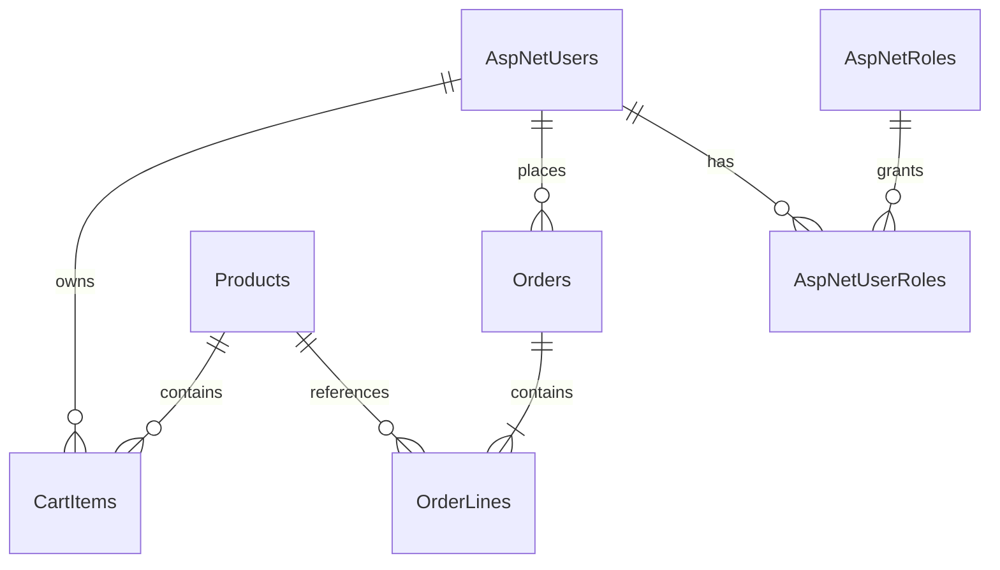

# Thiết kế database dùng chung

Ba ứng dụng tạo ba database độc lập, cùng schema; mỗi project có bộ migration riêng trong Data/Migrations. Các bảng Identity mặc định được giữ nguyên; `AspNetUsers` được mở rộng để lưu hồ sơ.

| Bảng | Dữ liệu / ràng buộc chính |
| --- | --- |
| AspNetUsers | Identity mặc định; FullName, Gender, DateOfBirth, PhoneNumber, Email, Address, City, IsDeleted; khóa dùng LockoutEnd/LockoutEnabled mặc định |
| AspNetRoles / AspNetUserRoles | Hai role User và Admin, role được gán bởi server |
| Products | Tên, thương hiệu, loại, giá decimal(18,2), tồn kho, mô tả, IsDeleted |
| CartItems | UserId, ProductId, Quantity; unique(UserId, ProductId), FK tới user và sản phẩm |
| Orders | UserId, CreatedAt (UTC), trạng thái, người nhận, SĐT, địa chỉ giao hàng, tổng tiền |
| OrderLines | OrderId, ProductId, tên sản phẩm và đơn giá tại thời điểm mua, số lượng |

Các bảng claims, logins, tokens và role claims của Identity vẫn được tạo trong migration. Mật khẩu được Identity băm, không lưu plaintext.

`IsDeleted` được áp dụng bằng global query filter cho user và sản phẩm. Đơn hàng và dòng đơn hàng không bị xóa theo sản phẩm/tài khoản, bảo toàn lịch sử. Giỏ hàng bị xóa khi đặt hàng thành công; sản phẩm bị xóa mềm được gỡ khỏi giỏ hàng.

Khi đặt hàng: đọc lại sản phẩm trong transaction Serializable, kiểm tra tồn kho, lưu order/lines và trừ kho, xóa các dòng giỏ hàng, rồi commit. Khi hủy đơn: chuyển trạng thái và hoàn kho cùng transaction; đơn đã hủy không được chuyển lại trạng thái hoạt động.
